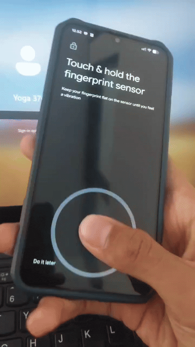

# A50-FOD-AOSP

Research on the in-display fingerprint (Egis ET713) of the Samsung Galaxy A50 (SM-A505F, a50dd) on AOSP-based ROMs.

**Status:** the FOD UI can be shown with an overlay. Enrollment does not work. The Trusted App returns error `38`.
One lead is open: PROCA and FIVE in the kernel. It is not tested.

## Test matrix

One row for each ROM, vendor and kernel combination. Add a row when you test something new.

| ROM | Android | Vendor | Kernel | FOD UI | Enroll | Result | Details |
| --- | --- | --- | --- | --- | --- | --- | --- |
| LineageOS 23.2 (GSI) | 16 | A505f-vendor (A505FDDS9CUK1) | Mint 1413, permissive | Works | Fails, error 38 | Closed | [results](results/lineageos-23.2-a16/README.md) |
| LineageOS 23.2 (GSI) | 16 | f4vendor (A505FDDS9CVA4) | Mint 1413, permissive | Not tested | Not tested | Dropped: broke Hotspot and Bluetooth | [report](docs/INVESTIGATION.md#10-vendor-comparison) |

Result values: Not tested, Partial, Closed (no fix found), Solved.

## What we know

- The error comes from the Trusted App, not from Android, SELinux, power, or cache files.
- The same error is expected on other GSIs that use the same vendor and kernel. This is not tested yet. Testing a second ROM with the same vendor and kernel would show if the ROM matters.
- On a stock Samsung ROM with the stock kernel, the fingerprint works.

## Preview



## Structure

```text
A50-UDFPS-AOSP/
├── .github/
│   └── ISSUE_TEMPLATE/
│       └── test-report.md        : Issue template for new test reports
├── docs/
│   ├── INVESTIGATION.md          : Full LineageOS 23.2 analysis & logs summary
│   ├── PROCA_FIVE_TEST_PLAN.md   : Open kernel lead & step-by-step test plan
│   └── vendor_structure.md       : A505f vendor partition layout
├── overlay/
│   ├── A50Udfps.apk              : UDFPS overlay APK
│   └── README.md                 : Overlay notes & setup
├── results/
│   ├── lineageos-23.2-a16/
│   │   ├── logs/                 : Capture & dmesg log files (21 files)
│   │   ├── README.md             : LineageOS 23.2 test summary
│   │   ├── udfps-touch-no-enroll.gif : Preview animation
│   │   └── udfps-touch-no-enroll.mp4 : Screen capture video
│   └── TEMPLATE.md               : Format template for new test entries
├── CONTRIBUTING.md               : How to submit a result
└── README.md                     : Matrix, preview & quick entry point
```

## Documents

| File | What it covers |
| --- | --- |
| [docs/INVESTIGATION.md](docs/INVESTIGATION.md) | Full report for LineageOS 23.2 |
| [docs/PROCA_FIVE_TEST_PLAN.md](docs/PROCA_FIVE_TEST_PLAN.md) | The one open lead, step by step |
| [docs/vendor_structure.md](docs/vendor_structure.md) | File tree of the A505f vendor image |
| [overlay/README.md](overlay/README.md) | The UDFPS overlay APK |
| [results/TEMPLATE.md](results/TEMPLATE.md) | Format for a new test |
| [CONTRIBUTING.md](CONTRIBUTING.md) | How to send a result |

## Releases

The Releases page holds the larger files:

- `fp-logs-filtered.zip`: filtered logs from the LineageOS 23.2 tests
- `device-overlays.zip`: two overlays copied from the device, for comparison

## Help

Telegram: https://t.me/ibralyam
